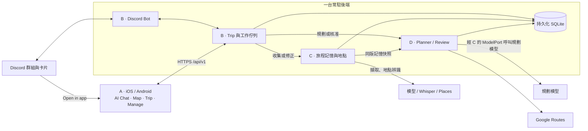

# Waymark M3 實作計畫｜從 Discord 分享到手機上的共同行程

**Group 4，2026/12/02 提交。** Mia 在 Discord 貼一則錦市場 Reel。朋友能在手機地圖找到同一個地方，看到誰分享、誰想去，請 AI 把它排進京都行程。Alex 可以先看第三天修改前後的差異，再決定要不要套用。這是四位組員要一起做通的旅程。目前 repo 提供規劃、型別和開發測資，手機 App、線上後端與測試包都待實作。

**先認領工作包，再拿第 5 節對應的任務開工。** A 做手機前端與發佈，B 做 Discord、API 與部署，C 做旅程記憶和地點，D 做規劃、交通和版本。第 2 節定義兩個入口共用的操作，第 4 節用同一趟關西行程驗收，文末附可直接複製的 TypeScript 契約。

## 產品範圍與畫板對照

畫面名稱、按鈕與操作層級依 M2 的 22 張畫板。簡報第 17–20 頁定義分享、整理／規劃、共同編輯三個情境，第 37–38 頁驗收修改、確認與儲存。簡報第 24、30 頁原提 Web App，本次交付改成可裝在 iPhone 與 Android 上的測試版。[M2 互動原型](https://claude.ai/artifact/75jXxDxX1EwALYK2eui1Xs) · [38 頁上台版](../milestone2/slides_presentation.pdf)

### 手機上的四個分頁

| 分頁與畫板 | 成員打開後能做什麼 | 完成的判準 |
|---|---|---|
| **AI Chat**　#1、#17 | 要求產生三日草案，或只規劃 Day 2 的 13:15–17:30。在嵐山、祇園、休息等有依據的方向中選一個，看建議站點及時段，可按 Apply 或 Keep original。從 Map 或 Trip 點 Ask AI 時帶入當天情境 | 兩個入口都能發起規劃。選祇園先得到待審預覽，只有按 Apply 才會改已接受行程 |
| **Map**　#2、#10 | 依城市或類別篩選、搜尋、點圖釘或候選卡看地點。詳情顯示地址、來源、備註、成員的四種反應；成員可打開原貼文或 Google Maps、選擇要加入的日期 | Mia 分享的錦市場在 Import log 與地圖都指向同一候選。加入 Day 2 經過提案，已排日期能從接受版讀回 |
| **Trip**　#3–6、#9 | 切日期、在地圖與時間表之間切換。展開交通比較時間、票價、轉乘和步驟，選 Use 預覽。Day 3 的兩隊可走不同路線，在 Namba Station 集合；未排候選留在 Drafts。修改預覽可 Edit、Apply 或 Keep original | M3 採 #3 左側時間軸，#4 上方時間帶保留為設計備選。#5 分組、#6 版本差異、#9 交通使用同一份行程，套用後兩端顯示同版 |
| **Manage**　#7 | 查看日期、城市、住宿、航班、步調、建立者與成員、連結的 Discord 頻道。分享邀請、開 Trip memory、匯出已接受版日曆 | 第二位有頻道權限的成員可從邀請加入；兩人看到相同旅程。匯出的日曆對應選定的已接受版本 |

**跨頁入口。** #8 Import log 從 AI Chat 或 Manage 的 Trip memory 開啟。列出已匯入、待補件和辨識失敗的來源，保留原分享者和時間。成員在來源仍獲授權時可按 Re-analyze 重試，或替 Riverside café 補地點。#13 TabBar、#14 AI button、#15 Place card、#16 Itinerary page 由 A 各實作一次，供前述畫面共用。

### Discord 的七種卡片

| 畫板 | 觸發與驗收 |
|---|---|
| **#18 Scope** | 首次提及 Waymark 時，成員選 From now on 或 Include earlier messages。B 記下頻道與授權起點。單次摘要再選 From reply／From here／All earlier，最多只能讀到已授權範圍 |
| **#11 Place card、#22 Clarify** | C 辨識到錦市場後，B 發地點卡，顯示原貼文、分享者、地圖連結和 Must go／Want to／No opinion／Skip。遇到缺店名的 Riverside café，成員可 Add place 或 Not this time，保留判斷的來源 |
| **#12 Summary & options、#19 Generate** | 摘要分 Decided／Undecided，標出涵蓋的訊息與時間。Memory only 保存摘要，Generate plan 產生待審草案，Open in app 回到該旅程或提案。成員投下午方向票，手機可讀回票數 |
| **#20 Change proposal、#21 Confirm & finish** | Mia 要求第三天從 08:30 改成 11:00 並跳過大阪城。接受後大阪城回候選區，第 1、2 天照舊。Confirm／Unconfirm 記錄本人對該版本的意見。Save & finish 先顯示保存內容，確認後暫停收集，重開仍可編輯 |

**這一週的取捨。** 先完成上表的操作。#7 的增減天數、改綁／解除頻道與刪除旅程排在三個情境通過之後，第一版顯示實際可用的控制項。#4 的替代版面也排在之後。M2 第 26 頁把主動推薦未分享的新地點及 LINE 列入後續；成員可以手動加地點。原型上的票數、票價與 AI 建議僅作測資，演示版本要顯示成員的實際選擇與執行結果。[M2 正式報告](../milestone2/GROUP_4_MILESTONE_2.pdf)

## 1. 誰負責哪個模組

每人認領一列。四個工作包共用一份 v1 契約，可先用第 4 節的測資獨立開發。所有目錄都相對於 `milestone3/`。

| 工作包 | 認領人 | 擁有的程式與決定 | 第一次交接 |
|---|---|---|---|
| **A　手機 App** | ＿＿ | `apps/mobile/`。Expo／React Native 的四個分頁、共用元件、登入回跳與深層連結、前景刷新、日曆分享、iOS／Android 安裝包 | 用測資從 Discord 連結打開指定提案，展示待審、接受後與過期三種狀態。將連結格式、真機測試結果交給 B |
| **B　Discord 與後端整合** | ＿＿ | `apps/server/src/{discord,http,trip,jobs}/`。七種卡片、登入、旅程權限、來源範圍、命令去重、背景工作與部署。把同一個操作轉給 C 或 D | 給 A 一個可用手機網路登入的 HTTPS 網址；給 C 一筆含授權範圍的來源；給 D 一筆有身分、版本及來源的規劃請求 |
| **C　記憶與地點** | ＿＿ | `apps/server/src/{memory,places,model}/`。Understand、Ground、摘要、匯入狀態、候選／偏好、成員修正、投票、Places 查詢及共用模型連線 | 交一份包含錦市場與兩個來源、待澄清咖啡店、已決／未決摘要及方向票的記憶快照。A 用來畫地圖，D 用來規劃 |
| **D　行程、交通與版本** | ＿＿ | `apps/server/src/{planner,routes,review}/`。Draft、Revise、路段比較、分組與集合、提案差異、接受版本、個別確認和日曆 | 交一筆會保留前兩天與分組的 Day 3 提案。A、B 都能用同一個 ID 檢視、接受或拒絕，再讀回同一版本 |

B 管共用 SQLite 連線、migration runner 和工作佇列，C、D 各管自己資料表的寫入與 migration。C 維護擷取及模型呼叫，D 維護規劃 prompt 和行程驗證。C 交地點與座標，D 交交通時間與選項，A 呈現與收集成員選擇。M2 提案的 Whisper／Places／Routes 與兩級模型由各自負責人用真實資料接通，記錄實際模型 ID、失敗情況與每趟成本，對照簡報的 US$2 估算。[M2 簡報第 23–25、28–31 頁](../milestone2/slides_presentation.pdf)



### 真機測試與後端部署

課程要求能依 README 在本機重現。為了讓組員和受測者離開開發電腦也能使用，團隊另外提供雙平台安裝包及一個固定的 HTTPS 網址。一台常駐主機即可執行 Fastify、Discord Bot 與工作處理，SQLite 放在重新部署仍保留的磁碟上。[M3 作業規格](https://docs.google.com/document/d/1f_e977FQVdIpVFO7rHM773MVLVu1sZUJekJLDzXhDFg/edit)

- **B 管網址。** Discord 旅程卡用 `/trips/{t}`，提案卡用 `/trips/{t}/proposals/{p}`。已安裝時開到指定內容，未安裝時同一網址顯示測試版安裝說明。A 處理冷啟動、背景返回、未登入後恢復原目的地；B 逐次驗證旅程權限。
- **A 管兩個安裝包。** Android 交付簽署的 APK。iOS 用團隊的 Apple Developer Program 帳號登記測試機 UDID，產生 ad hoc 安裝連結。A 提供 App ID、Android 套件名及簽章指紋，B 在網域的 `/.well-known/` 提供兩平台驗證檔。兩支手機均應能關掉開發電腦後從 Discord 進入同一筆提案。[Expo 安裝與簽署](https://docs.expo.dev/build/internal-distribution/) · [App 連結](https://docs.expo.dev/linking/overview/)

## 2. 大家共用的 API

A 的 App 經由 HTTPS 呼叫下表的路徑，全部以 `/api/v1` 開頭。B 的 Discord Bot 在同一個後端程序呼叫 `TripPort`。兩端共用旅程權限、操作與版本。可從附錄複製完整 TypeScript 型別，或從 repo 匯入。[共用契約](packages/contracts/src/index.ts)

### 手機從 Discord 登入

使用者從 Discord 開啟旅程或提案時，A 先在手機保存要開的 `tripId`、選用的 `proposalId` 與加入意圖。若尚未登入，A 產生隨機 `state` 和 PKCE `code_verifier`，暫存於 SecureStore，再用系統瀏覽器開啟登入網址。`code_challenge` 是 verifier 的 SHA-256 雜湊經 base64url 編碼（無 padding）。[原生 App 登入流程](https://www.rfc-editor.org/rfc/rfc8252) · [PKCE S256](https://www.rfc-editor.org/rfc/rfc7636)

| 方法與路徑 | 輸入 | 成功回應與用途 |
|---|---|---|
| GET `/auth/discord` | `MobileAuthStart` 的 query 欄位 | B 將 App 的 state 與 challenge 綁到本次登入，另產生一次性 Discord OAuth state 並綁定瀏覽器工作階段，302 到 Discord |
| GET `/auth/discord/callback` | Discord 回傳的 `state`，以及 `code` 或拒絕授權的 `error` | Discord 只回到已登記的後端 HTTPS 位址。B 驗證瀏覽器工作階段並核銷 OAuth state，在後端交換 Discord code、取得身分。B 只導向固定的 `waymark://auth/callback`，query 為 `MobileAuthReturn`，帶回原 App state。成功時附 Waymark 的一次性 code，使用者拒絕時附 `error=access_denied` |
| POST `/auth/mobile/exchange` | JSON `MobileExchange` | B 以原 challenge 驗證 verifier，再以單筆交易核銷綁定該成員、有效 60 秒的 Waymark code 並建立 session。200 `MobileSession`，`expiresAt` 是 24 小時後的 UTC ISO 8601 時間 |
| POST `/auth/logout` | `Authorization: Bearer <accessToken>`，空 body | B 撤銷本次手機 session，回 204。A 清除本機憑證，已失效回 401 時亦清除 |

A 只處理對應本次登入的 callback 和 state。成功後把 verifier 換成 Waymark session，將 token 存在 SecureStore，呼叫受保護的 API 時放入 Authorization header。App 回到先前保存的畫面，需要加入時先呼叫 `join` 再讀提案。B 只在後端保存 Discord 憑證，App 回呼網址只攜帶一次性結果。若取消或關掉瀏覽器，A 清除本次 verifier 和 state，保留目的畫面供重試。code 過期、已使用或 verifier 不符都回 401 `UNAUTHENTICATED`，A 重新啟動登入。B 遇到未通過驗證的 Discord state，在瀏覽器結束流程。

### 讀取資料與加入旅程

| 方法與路徑 | 送什麼 | 成功回應與用途 |
|---|---|---|
| GET `/me` | bearer token | 200 `Member`。A 用此 ID 顯示自己的地點票與版本確認 |
| GET `/trips` | bearer token | 200 `TripInfo[]`，列出已加入的旅程 |
| POST `/trips` | `NewTrip` | 201 `TripInfo`。B 驗證操作者可讀取指定頻道，以本人 ID 寫入 creatorId 並加入成員。每個測試頻道綁一趟旅程，重複綁定回 409 |
| POST `/trips/{t}/join` | 空 body | 200 `TripView`。邀請連結帶 trip ID，B 驗證登入者可讀取該旅程綁定的 Discord 頻道再加入 |
| GET `/trips/{t}` | 無 body | 200 `TripView`，包括基本資料、成員、收集狀態、記憶、已接受版本及待審提案。A 的四個分頁共用這份快照 |
| GET `/trips/{t}/proposals/{p}` | 無 body | 200 `Proposal`，可查看已套用、拒絕或過期的提案。Bot 卡片可用 ID 重新讀取狀態 |
| GET `/trips/{t}/jobs/{j}` | 無 body | 200 `Job`。輪詢至終態，取回提案、澄清問題、摘要、記憶版本或失敗原因 |
| GET `/trips/{t}/places/search?q=...` | 成員輸入的地名或地址 | 200 `Place[]`。B 驗證成員，C 搜尋 Places。選中的 placeId 可綁回原候選，或從地圖加新地點 |
| GET `/trips/{t}/routes?version=2&from=s1&to=s2&modes=rail,bus` | 已接受版本、同一段交通的站點 ID、允許的方式 | 200 `RouteOption[]`。預設 Rail + Bus。顯示可取得的時間、票價、轉乘、步驟。Use 將 optionId 送入手動提案。無可用選項回空陣列 |
| GET `/trips/{t}/calendar.ics?version=2` | 已接受版本號 | 200 `text/calendar`。D 匯出指定版本，A 以登入憑證讀取檔案，透過手機的分享選單匯出。版本不存在回 404 |

新旅程的 `collection=inactive`、`accepted=null`、基準行程版本為 0。B 由 bearer token 或 Discord 事件取得操作者，逐次檢查旅程與頻道權限，並檢查所用的 job、source、candidate、proposal 歸屬該旅程。Discord 按鈕可攜帶旅程與版本，但身分取自當下的點擊者。

### 操作與回應

所有操作都送到 **POST `/trips/{t}/commands`**。每一列的欄位放在同一個 JSON 物件。例：`{"kind":"confirm","planVersion":2}`。HTTP 回應使用下表的型別本身，不另包一層 `data`。

| `kind` | 除 kind 外的欄位 | 負責執行 | 成功回應 |
|---|---|---|---|
| `collect` | `scope: ReadScope` | B，確認範圍後啟動或恢復 | 200 `TripView` |
| `pause` | 無 | B，保存目前接受版、停止收集 | 200 `TripView` |
| `edit_memory` | `memoryRevision, edit: MemoryEdit` | C，人工補景點、澄清、改偏好、排除或投票 | 200 `TripView` |
| `retry_import` | `sourceId` | B 載入原先獲准的分享與媒體，C 重試該筆失敗的匯入 | 202 `JobRef`，成功結果為 `{kind:"memory",revision}` |
| `summarize` | `range: SummaryRange` | B 篩選獲准訊息，C 保存摘要、筆記及可選的方向投票，回傳 summaryId | 202 `JobRef` |
| `plan` | `base: Base, request: PlanRequest, replacesProposalId?` | B 固定輸入快照，D 生成首案、自然語言修改或手動修改的預覽 | 202 `JobRef` |
| `answer` | `jobId` 及 `text` 或 `optionId`，二選一 | B 讀出原規劃工作保存的 `clarify`。選項 ID 須屬於該題，再將回答與來源交給 D | 202 新的 `JobRef` |
| `decide` | `proposalId, action: "apply" 或 "reject"` | D，套用或拒絕指定提案 | 200 `TripView` |
| `confirm`／`unconfirm` | `planVersion` | D，記錄或撤回呼叫者對該版本的同意 | 200 `TripView` |

來源 `sourceId`、候選 `candidateId`、地點供應商的 `placeId` 和行程站點 `stopId` 分開使用。同一地點的多則分享可以合併成一個候選，同一候選可以出現在不同站點。A 用這些 ID 連起原文、地點卡與行程，保留被移出行程的候選。

### 原型按鈕如何接到契約

| 入口 | 讀取與操作 |
|---|---|
| **AI Chat** | 生成首案送 `plan/draft`，修改接受版送 `plan/revise`。規劃 Day 2 下午時指定 `request.context.date` 和帶 UTC offset 的 `window.start/end`。A 保存 jobId。若結果是 `clarify`，點 B · Gion 送 `answer {jobId,optionId}`，也可回覆文字。若沿用已保存的摘要選項，在規劃請求的 context 傳 `selectedOption:{summaryId,pollId,optionId}`。這兩條路都可取得待審提案。Discord 投方向票另送 `edit_memory/vote_option`。 |
| **Map／Place details** | Map 依座標畫點，用 place.city 與候選標籤篩選。Place details 讀地址、來源及成員反應。四種票依序對應 `heart/check/minus/cross`。筆記用 `edit_memory/set_candidate_note`（`candidateId,text`，傳 null 清除本人筆記）。點 Day 1／2／3 後選時段，以 `plan/manual` 加入 `add_stop`，預覽通過才寫入該日。移除一站用 `remove_stop`，略過整個候選用 `edit_memory/exclude`。 |
| **Trip／Transport** | 用 `accepted.itinerary.days` 畫時間表、分組與會合點，從未排入且未排除的候選顯示 Drafts。點交通段帶入該版本與首尾 stop ID，按 Use 送 `plan/manual` 的 `choose_route`。提案畫面用 `proposal.preview/differences/warnings`。Apply 與 Keep original 分別對應 `decide/apply`、`decide/reject`。 |
| **Manage／Trip memory** | Manage 從 `trip` 讀名稱、日期、時區、`creatorId`、`details`（城市、住宿、航班、步調）和 B 從 Discord 取得的 `channelName`（缺值時顯示 `channelId`），從 `members` 顯示成員。缺少選填資料時顯示未提供。M3 核心提供唯讀資料、分享加入連結與匯出 .ics。Trip memory 以 `memory.sources[].importState` 顯示匯入進度、結果與失敗原因，再依 `candidate.sourceIds` 找到地點。Re-analyze 用 `retry_import`，Needs details 用搜尋 → `edit_memory/resolve`。 |
| **Discord · Scope、Place card、Clarify** | Scope 的選擇送 `collect`。獲准分享完成後，Place card 以 `edit_memory/vote` 記錄實際按鈕者。Clarify 的 Add place 用搜尋與 `resolve` 綁回原候選，Not this time 用 `exclude`。 |
| **Discord · Summary & options、Generate、Change proposal、Confirm & finish** | `summarize` 產生摘要卡，Memory only 停在已存的摘要。Generate plan 和 Edit 經 `plan` 產生提案。Open in app 打開旅程或該提案。變更卡呼叫 `decide`，版本卡呼叫 `confirm/unconfirm`。Save & finish 先顯示保存內容，成員確認後送 `pause`。 |

旅程的三種 POST（建立、加入、commands）各帶 `Idempotency-Key`，例如一次點擊產生的 UUID。Bot 使用 Discord interaction ID。索引以操作者、路徑、key 為範圍。完全相同的重試回原先結果或同一個 job ID，用相同 key 送不同內容回 409。登入交換與登出各用上方的憑證規則。A 在旅程畫面開啟時短輪詢，App 回到前景時重讀快照，以伺服器回傳的版本為準。

### 錯誤與狀態

| 情況 | 回應 | 呼叫端行為 |
|---|---|---|
| 尚未登入、session 過期或已撤銷／無權存取旅程 | 401 `UNAUTHENTICATED`／403 `FORBIDDEN` | 401 清除失效憑證，保存原畫面目的地並顯示登入入口。403 說明所需頻道權限 |
| 旅程中的物件不存在 | 404 `NOT_FOUND` | 重新載入旅程 |
| 格式或參照錯誤／已知不可行的行程 | 422 `INVALID_INPUT`／`INFEASIBLE` | 顯示原因，讓使用者修改 |
| 基準過期／提案已結案／key 重用 | 409 `STALE_BASE`／`ALREADY_DECIDED`／`KEY_REUSED` | 取回最新快照，重新預覽後再操作 |
| 匯入已完成或已超出本次收集範圍 | 409 `IMPORT_NOT_RETRYABLE` | 重新讀取該筆 Import log。失去旅程或頻道讀取權仍回 403 |
| 外部模型或地圖服務失敗 | 已受理的 job 進入 `failed`，附 `UPSTREAM_UNAVAILABLE` 與原因 | 顯示重試。單站缺少營業時間、交通估計則以 warning 或 null 呈現 |

錯誤 body 格式為 `{"error":{"code":"STALE_BASE","message":"Refresh this trip and review the new version.","current":{"planVersion":2,"memoryRevision":4}}}`。若 job 開始後才發現資料已變動，查詢 job 仍回 HTTP 200，body 的 `status` 為 `failed`，`error.code` 同樣為 `STALE_BASE`。掛起的 job 可回 `queued` 或 `running`，停止收集而取消的擷取工作回 `cancelled`。

## 3. 後端模組怎麼接

| 介面與負責人 | 呼叫者 | 輸入、輸出與責任 |
|---|---|---|
| `TripPort` · B | A 的 HTTP client、B 的 Discord adapter | 驗證 actor、旅程與權限。以 `forChannel` 找旅程、`onMessage` 收獲准分享、`run` 接成員操作，回傳 `TripView` 或 `JobRef`。保存 Discord 卡片的 channel/message ID 與對應的候選、提案或版本。App 或 Bot 寫入成功後，B 用已提交的狀態更新原卡片，Discord 暫時失敗時重試。 |
| `MemoryPort`、`TranscriptionPort`、`ModelPort` · C | B 提供來源、C 擷取與整理、D 讀地點事實與呼叫模型 | `ingest` 接已核可的來源和媒體，必要時轉錄可取得的音訊。`snapshot` 回傳同一個 revision 的候選、偏好、來源與摘要。`searchPlaces`、`facts` 回地點及營業區間。C 和 D 各自驗證模型 JSON 與來源 ID。 |
| `PlannerPort`、`RoutesPort` · D | B 的規劃工作、D 的 Planner | 固定 `GenerationInput` 的旅程、記憶、接受版本、請求及補答。首案回 `drafted`，修改回有型別的 `patch`，缺資訊可回 `clarify` 與附來源的選項。比較路線時傳地點、出發時間、可接受的交通方式。 |
| `ReviewPort` · D | B 的工作佇列與同步操作 | `propose` 計算預覽及與接受版的差異。`decide` 接受或拒絕指定提案，`setConfirmation` 寫入實際操作者對該版本的意見，`calendar` 匯出指定接受版本。 |

**收集與 Import log。** B 在呼叫 C 之前保存來源和工作狀態，故模型失敗仍查得到原分享。未啟用、已暫停、超出範圍的頻道訊息不排入工作。C 合併同一地點的來源，保留人工修正。私人影片或模糊名稱可留下待補資料的候選。B 在 `Source.importState` 提供這筆分享最近一次匯入的 job ID 與狀態。成功可為 imported 或 needs_details，失敗附 reason，因暫停而取消則為 cancelled。重試須是該旅程有權讀取、仍在本次收集範圍內的失敗分享。B 載入原本的媒體，並讓同一來源只執行一個重試工作。暫停後取消舊工作，每次恢復增加 epoch，C 在寫入時再比對 epoch 與狀態。只有影響規劃的記憶變更才增加 revision。

**兩端的使用者輸入。** B 將手機的要求或補答記為 `origin=app`、`url=null`，作者取自 session。Bot 呼叫非同步 `run` 時可傳內部參數 `discordSource`，標為 `origin=discord` 並保留真實的 Discord 原文連結。外部 Reel 或貼文的網址另存 `sharedPost`。只有要匯入的分享才帶 `importState`。B 把來源 ID 放進規劃輸入，C、D 只使用該旅程獲准的來源。B 用同一操作 key 重試時，須取回原來源與原 job。

**Day 2 的方向選擇。** D 以指定日期、時間窗和既有候選產生選項，C 提供已知營業時間，未知為 null。使用者按選項後，B 依原 job 取回選項與來源，將選項放入 GenerationInput.answers 的 selectedOption。選項不存在回 422 INVALID_INPUT。若引用先前的方向票，則驗證 summary/poll/option 彼此隸屬。D 保留其他日期與時段，將結果送入同一個提案審閱流程。需要補地名時，用搜尋與 `resolve` 修正原候選，再從最新 revision 規劃。無法排入時段或分組後無法準時會合，回傳具體衝突供成員修正。

**摘要與路線。** `collect.scope` 決定可讀的訊息。`summarize.range` 選其中一段來整理。From reply 從被回覆訊息、From here 從指定訊息算起，All earlier 涵蓋已授權的歷史，截止於成員提出摘要要求時。C 保存時間範圍、訊息數、Decided／Undecided 及其來源，供兩端再次開啟。交通比較按指定版本、路段與出發時間查詢，保留每種方式可取得的步驟、時間、票價和轉乘。無方案回空陣列，缺資料的數值回 null。成員選用路線後仍可先預覽。

**接受、拒絕與確認。** B 維護 SQLite 連線與 migration runner，各人維護自己模組的資料表。網路請求在交易外執行。D 建提案和套用時都比對 `base.planVersion` 與 `base.memoryRevision`。Apply 在同一筆交易內檢查 pending、寫入新版、結束提案並記錄操作結果。Reject 只結束提案。每個新版本從零位成員確認開始。Edit 以 `replacesProposalId` 指向的預覽作起點，新提案存妥後將舊提案標為 stale，並相對於已接受版本列出完整差異。Save & finish 暫停收集後仍可重開同一版行程、查看來源與待確認者。

## 4. 三個可重跑的整合情境

用同一趟 Kansai Fall Trip（`osaka`，`Asia/Tokyo`，11/20–22），分別還原每個情境的起始狀態。Mia、Alex、Ben、Yuki 各有自己的身分。以下是開發用合成資料與預期結果。測試版驗收時，把同一套步驟放到經同意的 Discord 測試頻道與實機上執行，記下實際結果。

| 情境與畫板 | 從哪裡開始 | 兩端怎麼驗收 |
|---|---|---|
| **① Mia 分享，Ben 補地點**。11、8、10、22 | 在已啟用的頻道分享錦市場 Reel，同一地點再由另一人分享一次。Ben 的 Riverside café 只有名稱線索 | Discord 出現含來源的地點卡。App 的 Map 和 Import log 找得到同一個候選、兩筆來源及每位成員的反應。Ben 從 Add place 選定地址後保留原來源。另以解析失敗的貼文測一次 Re-analyze，重送只產生同一份工作結果 |
| **② Alex 選祇園，讓 AI 預覽下午的安排**。12、1、17、9 | 先給 Day 2 留 13:15–17:30 空檔，備妥已分享、可辨識的候選。Discord 摘要列 Decided／Undecided 及方向投票。以 `sum2/poll2/gion` 識別祇園選項 | 在 App 的 AI Chat 選 Gion，讀回只改 Day 2 下午的待審預覽，原版與投票數維持原值。Keep original 後空檔仍在。從同一基準重跑並 Apply，再看 Trip 時段及兩站的 Transport。另從空行程測一次 Generate，Apply 後才有 v1 |
| **③ 第三天晚出發，兩組仍能會合**。5、6、20、21 | 還原下方 v1，Mia 在 Discord 說「第三天十一點出發，跳過大阪城」。兩組已約好 16:00 在 Namba Station 會合 | 手機顯示 v1→待審差異，兩個入口都能 Keep original。Alex 按 Apply 後顯示 v2、0/4，Mia 再 Confirm 才是 1/4。大阪城回到候選，兩組的成員及會合站保留，第 1、2 天逐欄相同。Save & finish 可取消，完成後暫停收集。重開 App 仍可從 Manage 匯出 v2 的日曆 |

**情境 ② 的請求。** `vote_option` 記錄成員在 Discord 對方向的意見。按 AI Chat 的 Gion 按鈕會提出以下 `POST /api/v1/trips/osaka/commands`。三個方向先存在 `SavedSummary.poll`，整理時使用的訊息可從摘要筆記追溯。若成員直接從 App 詢問空檔，伺服器也可回傳附選項的 `clarify`。A 送 `answer`、該次 `jobId` 與 `optionId` 取得預覽。每個 POST 範例另帶一次操作的 `Idempotency-Key`。

```json
{
  "kind":"plan","base":{"planVersion":1,"memoryRevision":4},
  "request":{"kind":"revise","instruction":"請把祇園散步排進第二天下午",
    "context":{"date":"2026-11-21","window":{"start":"2026-11-21T13:15:00+09:00","end":"2026-11-21T17:30:00+09:00"},
      "selectedOption":{"summaryId":"sum2","pollId":"poll2","optionId":"gion"}}}
}
```

**情境 ②、③ 的共同起點。** A 用下方 JSON 模擬 `GET /api/v1/trips/osaka`，B–D 用同一份 `TripView` 建測資。每次測試都還原 v1。測試「先從 App 詢問」時清空 `summaries`，保留同一批來源與候選，確認 AI 仍能給出有依據的方向。範例座標僅供畫面測試，真實分享需可回查原文，交通時間用實際查詢結果。

<details>
<summary>展開可直接載入的 TripView 測資</summary>

```json
{
  "trip":{"id":"osaka","name":"Kansai Fall Trip","channelId":"ch1","channelName":"kansai-trip","timezone":"Asia/Tokyo","firstDate":"2026-11-20","lastDate":"2026-11-22","creatorId":"mia","details":{"cities":["Osaka","Kyoto"],"stay":"Namba hotel","flights":null,"pace":["Relaxed","Less walking"]}},
  "members":[{"id":"mia","name":"Mia"},{"id":"alex","name":"Alex"},{"id":"ben","name":"Ben"},{"id":"yuki","name":"Yuki"}],
  "collection":"active","epoch":1,"scope":{"mode":"from_now"},
  "memory":{"revision":4,"preferences":[],
    "summaries":[{"id":"sum2","range":{"mode":"from_here","messageId":"ky1"},"firstAt":"2026-11-19T18:05:00+09:00","lastAt":"2026-11-19T18:06:00+09:00","messageCount":2,
      "notes":[{"id":"n1","state":"decided","text":"Lunch at Nishiki Market.","sourceIds":["ky1"]},{"id":"n2","state":"undecided","text":"Day 2 afternoon is open until 17:30.","sourceIds":["ky1","ky2"]}],
      "poll":{"id":"poll2","question":"How should we spend the afternoon?","options":[{"id":"arashiyama","label":"Arashiyama","voterIds":["ben"]},{"id":"gion","label":"Gion · Old-town stroll","voterIds":["mia","alex"]},{"id":"rest","label":"Keep time free","voterIds":[]}]}}],
    "sources":[
      {"id":"m1","origin":"discord","authorId":"mia","text":"Nishiki Market on Day 2, Osaka Castle on Day 3.","url":null,"at":"2026-11-19T18:00:00+09:00"},
      {"id":"m2","origin":"discord","authorId":"ben","text":"Start at Namba Station on Day 1. After lunch in Shinsekai on Day 3, Mia and Yuki visit Umeda Sky Building, Alex and Ben visit Tsutenkaku. Meet at Namba Station at 16:00.","url":null,"at":"2026-11-19T18:01:00+09:00"},
      {"id":"ky1","origin":"discord","authorId":"alex","text":"After lunch at Nishiki Market, we have 13:15–17:30 free. We could visit Yasaka Shrine and walk along Hanamikoji in Gion.","url":null,"at":"2026-11-19T18:05:00+09:00"},
      {"id":"ky2","origin":"discord","authorId":"ben","text":"Or visit Arashiyama Bamboo Grove, or simply leave the afternoon free.","url":null,"at":"2026-11-19T18:06:00+09:00"}
    ],
    "candidates":[
      {"id":"castle","label":"Osaka Castle","state":"resolved","place":{"id":"place-castle","name":"Osaka Castle","coordinates":null},"choices":[],"sourceIds":["m1"],"votes":[]},
      {"id":"lunch","label":"Shinsekai · Lunch","state":"resolved","place":{"id":"place-lunch","name":"Shinsekai · Lunch","coordinates":null},"choices":[],"sourceIds":["m2"],"votes":[]},
      {"id":"namba","label":"Namba Station","state":"resolved","place":{"id":"place-namba","name":"Namba Station","coordinates":null},"choices":[],"sourceIds":["m2"],"votes":[]},
      {"id":"umeda","label":"Umeda Sky Building","state":"resolved","place":{"id":"place-umeda","name":"Umeda Sky Building","coordinates":null},"choices":[],"sourceIds":["m2"],"votes":[]},
      {"id":"tsuten","label":"Tsutenkaku","state":"resolved","place":{"id":"place-tsuten","name":"Tsutenkaku","coordinates":null},"choices":[],"sourceIds":["m2"],"votes":[]},
      {"id":"nishiki","label":"Nishiki Market","state":"resolved","place":{"id":"place-nishiki","name":"Nishiki Market","city":"Kyoto","coordinates":{"lat":35.005,"lng":135.765}},"choices":[],"sourceIds":["m1","ky1"],"votes":[]},
      {"id":"yasaka","label":"Yasaka Shrine","state":"resolved","place":{"id":"place-yasaka","name":"Yasaka Shrine","city":"Kyoto","coordinates":{"lat":35.004,"lng":135.778}},"choices":[],"sourceIds":["ky1"],"votes":[]},
      {"id":"hanamikoji","label":"Hanamikoji","state":"resolved","place":{"id":"place-hanamikoji","name":"Hanamikoji","city":"Kyoto","coordinates":{"lat":35.002,"lng":135.775}},"choices":[],"sourceIds":["ky1"],"votes":[]},
      {"id":"bamboo","label":"Arashiyama Bamboo Grove","state":"resolved","place":{"id":"place-bamboo","name":"Arashiyama Bamboo Grove","city":"Kyoto","coordinates":null},"choices":[],"sourceIds":["ky2"],"votes":[]}
    ]
  },
  "accepted":{"version":1,"confirmedBy":[],"itinerary":{"days":[
    {"date":"2026-11-20","departAt":"2026-11-20T10:00:00+09:00","stops":[{"id":"s1","candidateId":"namba","start":"2026-11-20T10:00:00+09:00","end":"2026-11-20T10:15:00+09:00","sourceIds":["m2"]}],"legs":[],"split":null},
    {"date":"2026-11-21","departAt":"2026-11-21T12:00:00+09:00","stops":[{"id":"s2","candidateId":"nishiki","start":"2026-11-21T12:00:00+09:00","end":"2026-11-21T13:15:00+09:00","sourceIds":["m1"]}],"legs":[],"split":null},
    {"date":"2026-11-22","departAt":"2026-11-22T08:30:00+09:00",
     "stops":[
       {"id":"sCastle","candidateId":"castle","start":"2026-11-22T09:30:00+09:00","end":"2026-11-22T11:30:00+09:00","sourceIds":["m1"]},
       {"id":"sLunch","candidateId":"lunch","start":"2026-11-22T12:15:00+09:00","end":"2026-11-22T12:45:00+09:00","sourceIds":["m2"]},
       {"id":"sMeet","candidateId":"namba","start":"2026-11-22T16:00:00+09:00","end":"2026-11-22T16:15:00+09:00","sourceIds":["m2"]}
     ],
     "legs":[{"fromStopId":"sCastle","toStopId":"sLunch","mode":"transit","minutes":null}],
     "split":{"afterStopId":"sLunch","meetingStopId":"sMeet","branches":[
       {"memberIds":["mia","yuki"],"stops":[{"id":"sUmeda","candidateId":"umeda","start":"2026-11-22T13:25:00+09:00","end":"2026-11-22T14:30:00+09:00","sourceIds":["m2"]}],"legs":[{"fromStopId":"sLunch","toStopId":"sUmeda","mode":"transit","minutes":null},{"fromStopId":"sUmeda","toStopId":"sMeet","mode":"transit","minutes":null}]},
       {"memberIds":["alex","ben"],"stops":[{"id":"sTsuten","candidateId":"tsuten","start":"2026-11-22T13:00:00+09:00","end":"2026-11-22T14:00:00+09:00","sourceIds":["m2"]}],"legs":[{"fromStopId":"sLunch","toStopId":"sTsuten","mode":"transit","minutes":null},{"fromStopId":"sTsuten","toStopId":"sMeet","mode":"transit","minutes":null}]}
     ]}
    }
  ]}},
  "pending":[]
}
```

</details>

**用同一筆提案測版本。** B 把 Mia 的修改請求記為新來源 `m3`，先回傳 `202 {"jobId":"j7"}`。背景工作由 D 產生下面的 `DraftResult`，驗算預覽的站點、交通與分組。App 輪詢 `GET /api/v1/trips/osaka/jobs/j7` 得到 `proposalId=p7`，再讀 `GET /api/v1/trips/osaka/proposals/p7`。按 Apply 送 `{"kind":"decide","proposalId":"p7","action":"apply"}`，另一次 Confirm 送 `{"kind":"confirm","planVersion":2}`。

```json
{
  "kind":"patch","changes":[
    {"kind":"retime_day","date":"2026-11-22","departAt":"2026-11-22T11:00:00+09:00"},
    {"kind":"remove_stop","stopId":"sCastle"}
  ],
  "sourceIds":["m3"],"warnings":[]
}
```

**重送與競爭。** 從同一份 v1 建兩個待審提案，用兩支手機分別套用。一次成功，另一支應收到 409 並顯示新版本。成功端因斷線以相同 key 重送，應讀回第一次的 v2。再從 v1 獨立測 Keep original，確認版本與分組都未變。暫停收集後才抵達的擷取結果應被捨棄。

## 5. 四個人怎麼和各自的 AI 開工

每個人把這份 Markdown、認領的畫板編號和下列任務交給自己的 coding AI。路徑以 `milestone3/` 為根。第一輪用同一份測資確認介面，第二輪在測試頻道與真機重做同一個動作。交接時附啟動指令、輸入、回應或錄影，其他人便能獨立驗收。

| 認領 | 可直接交給 AI 的第一個任務 | 交給誰、怎麼驗收 |
|---|---|---|
| A · 手機 | 「在 `apps/mobile/` 建 Expo App，以 AI Chat、Map、Trip、Manage 為底部導覽。用 §4 的 v1，在 Trip 以畫板 3 的左側時間軸顯示第三天兩組與會合點，再做畫板 6 的差異預覽。讓同一個 API client 能切換測資和 B 的網址。」 | 給 B 兩個實機安裝連結。未登入者點 Discord 的 p7，登入後回到 p7。Apply 成功顯示 v2，409 能重新讀取 |
| B · Discord 與部署 | 「在 `apps/server/src/{trip,discord,http,jobs}/` 把已部署的 Fastify、Bot、SQLite 接到同一個大阪旅程。先做 #18 啟用與 #20–21 跨端核准。用測試頻道的真實訊息、手機登入及邀請連結驗證同一個人與同一版，再接分享、摘要與澄清卡。」 | 給 A 手機可連的 HTTPS 網址、旅程及提案連結。給 C 已獲授權的訊息，給 D 帶來源的請求。重啟後仍能讀回 v2 |
| C · 記憶與地點 | 「在 `apps/server/src/{memory,places,model}/` 用錦市場兩筆分享、解析失敗的貼文和 Ben 的 Riverside café 測擷取。用同一份記憶供應 #11 地點卡、#8 Import log、#10 詳情及 #12 摘要，示範一次經授權的重試和一次人工補地點。」 | B 和 A 能用相同候選 ID 取得去重後的兩筆來源與投票。D 拿到可引用的候選、偏好與祇園方向選項 |
| D · 行程與核准 | 「在 `apps/server/src/{planner,routes,review}/` 用 §4 的大阪 v1 實作第三天修改，保留兩組成員與會合點。用同一個預覽流程處理 AI Chat 選 Gion、手動從候選加站與改選交通。用 SQLite 驗證拒絕、套用、重送以及個別確認。」 | 給 A、B 一筆 pending 提案，能列出受影響站點、交通及來源。兩入口讀到相同 v2，第一次 Apply 後仍是 0/4 |

B 維護 workspace、部署設定及 migration 執行順序。B、C、D 各自負責所屬的資料表。要動 `packages/contracts/src/index.ts` 時，提出者與呼叫方先用 §4 範例核對欄位，再一起更新本文附錄。

## 6. 一週內接起來與交件

| 日期 | 當天要能在別人的裝置上重現什麼 |
|---|---|
| **11/25** | 四人認領並跑通同一份 v1 測資。A 確認 iOS 簽署帳號與測試機 UDID，B 取得 Discord 測試頻道、網域和持久磁碟，C、D 各跑通一次實際模型或地圖服務 |
| **11/26** | A 提供 Android APK、已登記 iPhone 的 ad hoc 安裝連結。兩支真機使用行動網路從 Discord 開啟指定旅程。尚未安裝時顯示安裝引導，安裝後再點原連結。B 在部署主機重啟服務後仍讀得到資料 |
| **11/27** | 跑情境①。B 開啟收集範圍，C 接真實分享並補正地點。A 在兩部手機的 Map／Trip memory 驗收來源、投票與重複分享 |
| **11/28** | 跑情境②。從已授權摘要或 App 的 AI Chat 取得祇園方向提案。D 驗證指定時段與交通，A 示範 Keep original 和 Apply 的不同結果 |
| **11/29** | 跑情境③。兩位成員完成跨端修改、確認、Save & finish、重開及匯出日曆。核對 §4 的重試與 409 案例 |
| **11/30** | 請沒看過設計的朋友先只讀英文 User Flows，再自行走上述 2–3 個情境。記下哪一步需要提示、完成時間、手機型號、測試版號與實際結果 |
| **12/01–02** | 12/01 由一位組員在乾淨環境按英文 README 本機啟動，另一人用釋出的測試版走一遍。凍結同一版本完成錄影、報告及 ZIP，12/02 由一人提交 |

**若整合落後。** 先保住「分享能追來源、AI 可預覽與拒絕、兩端同版且逐人確認」三段操作。畫板 4 的上方時間帶可留作 A/B 比較，Manage 的進階管理操作依前述範圍排在核心驗收後。排程變動由負責人記下受影響的 M2 情境、目前可操作部分及替代展示。展示真實服務的步驟與合成測資要在報告標明。

**評估與交件。** 全部繳交材料均以英文撰寫或錄製。C 依 M2 評估計畫，以約三份經同意的聊天標記地點、偏好與重複分享，記錄正確率及虛構地點數（目標 0）。D 整理使用者是否能辨認待審／已套用、可否拒絕，以及是否理解停止收集。目標邀 3–5 組朋友，報告寫實際組數、任務、預期／實際結果與限制。A 負責 2–4 分鐘英文 MP4，給評閱者看到真實模型呼叫與人在兩端的決定。B 負責可本機重跑的程式 ZIP、英文 README、`.env.example`、帳號及安裝步驟。C、D 彙整 6–8 頁英文 PDF。團隊另交測試版安裝連結與線上後端，逐項核對影片、報告、程式與版號。[M3 作業規格](https://docs.google.com/document/d/1f_e977FQVdIpVFO7rHM773MVLVu1sZUJekJLDzXhDFg/edit) · [M2 互動原型](https://claude.ai/artifact/75jXxDxX1EwALYK2eui1Xs)

## 附錄 · 可直接交給 AI 的 TypeScript 契約

日期用 YYYY-MM-DD。每天的 `departAt` 是團體出發的時間，第一個停留點的 `start` 是抵達後開始造訪的時間。站點與交通出發時間用帶 UTC offset 的 ISO 8601 字串。所有 ID 為字串。stop ID 跨版本保持穩定。重新排序時傳完整的同日主線 stop ID，分組時以共同站點 ID 指定分開與集合位置。資料未知使用 null。當 `accepted` 為 null，新的規劃請求傳 `base.planVersion=0`。每個範例中的 `{t}`、`{p}`、`{j}` 都使用前一步取得的 ID 代入。

<details>
<summary>展開完整型別與模組函式簽名</summary>

```ts
// Waymark v1. These declarations are shared by the mobile app, Discord adapter and server.
export type Id = string
export type Actor = { memberId: Id } // Created by the server from an authenticated session or Gateway event.
export type Member = { id: Id; name: string }
export type MobileAuthStart = { state: string; code_challenge: string; code_challenge_method: 'S256' }
export type MobileAuthReturn =
  | { state: string; code: string }
  | { state: string; error: 'access_denied' }
export type MobileExchange = { code: string; code_verifier: string }
export type MobileSession = { tokenType: 'Bearer'; accessToken: string; expiresAt: string }
export type ReadScope =
  | { mode: 'from_now' | 'history' }
  | { mode: 'from_message'; messageId: Id }

// A summary selects raw messages inside the already authorized collection window.
export type SummaryRange =
  | { mode: 'from_reply' | 'from_here'; messageId: Id }
  | { mode: 'all_earlier' }
export type Reaction = 'heart' | 'check' | 'minus' | 'cross'
export type SavedSummary = {
  id: Id; range: SummaryRange; firstAt: string; lastAt: string; messageCount: number
  notes: { id: Id; state: 'decided' | 'undecided'; text: string; sourceIds: Id[] }[]
  poll: { id: Id; question: string; options: { id: Id; label: string; voterIds: Id[] }[] } | null
}
export type ImportState =
  | { status: 'queued' | 'running' | 'cancelled' | 'imported' | 'needs_details'; jobId: Id }
  | { status: 'failed'; jobId: Id; reason: string }
export type Source = {
  id: Id; authorId: Id; text: string; url: string | null; at: string
  origin?: 'app' | 'discord'
  importState?: ImportState
  sharedPost?: { url: string; platform: string; author: string | null; thumbnailUrl: string | null }
}
export type ScopedSource = {
  tripId: Id; epoch: number; source: Source
  media: { kind: 'link' | 'image' | 'video' | 'audio'; url: string }[]
}
export type Place = {
  id: Id; name: string; coordinates: { lat: number; lng: number } | null
  address?: string; city?: string
}
export type Candidate = {
  id: Id; label: string; state: 'unresolved' | 'resolved' | 'excluded'
  place: Place | null; choices: Place[]; sourceIds: Id[]
  votes: { memberId: Id; value: Reaction }[]
  notes?: { memberId: Id; text: string }[]
  tags?: string[]; description?: string
}
export type Preference = {
  id: Id; memberId: Id; text: string; confirmed: boolean; sourceIds: Id[]
}
export type MemorySnapshot = {
  summaries: SavedSummary[]
  revision: number; candidates: Candidate[]; preferences: Preference[]; sources: Source[]
}
export type MemoryEdit =
  | { kind: 'resolve'; candidateId: Id; placeId: Id }
  | { kind: 'add_place'; label: string; url?: string; placeId?: Id }
  | { kind: 'exclude'; candidateId: Id }
  | { kind: 'preference'; preferenceId: Id; text: string; confirmed: boolean }
  | { kind: 'vote'; candidateId: Id; value: Reaction | null }
  | { kind: 'set_candidate_note'; candidateId: Id; text: string | null }
  | { kind: 'edit_note'; summaryId: Id; noteId: Id; text: string }
  | { kind: 'vote_option'; summaryId: Id; pollId: Id; optionId: Id | null }

export type Mode = 'walk' | 'rail' | 'bus' | 'taxi' | 'bike' | 'drive'
export type RouteOption = {
  id: Id; minutes: number | null; fare: { amount: number; currency: string } | null
  transfers: number | null; steps: { mode: Mode; label: string; minutes: number | null }[]
}
export type Stop = {
  id: Id; candidateId: Id; start: string; end: string; sourceIds: Id[]
}
export type Leg = {
  fromStopId: Id; toStopId: Id; mode: Mode | 'transit'; minutes: number | null; route?: RouteOption
}
export type Branch = { memberIds: Id[]; stops: Stop[]; legs: Leg[] }
export type Day = {
  date: string; departAt: string; stops: Stop[]; legs: Leg[]
  split: { afterStopId: Id; branches: [Branch, Branch]; meetingStopId: Id } | null
}
export type Itinerary = { days: Day[] }
export type AcceptedPlan = { version: number; itinerary: Itinerary; confirmedBy: Id[] }
export type ManualChange =
  | { kind: 'add_stop'; date: string; candidateId: Id; start: string; end: string }
  | { kind: 'remove_stop'; stopId: Id }
  | { kind: 'retime'; stopId: Id; start: string; end: string }
  | { kind: 'retime_day'; date: string; departAt: string }
  | { kind: 'reorder'; date: string; stopIds: Id[] }
  | { kind: 'split'; date: string; split: Day['split'] }
  | { kind: 'choose_route'; fromStopId: Id; toStopId: Id; optionId: Id }
export type PlanContext = {
  date: string
  window?: { start: string; end: string }
  selectedOption?: { summaryId: Id; pollId: Id; optionId: Id }
}
export type PlanRequest =
  | { kind: 'draft'; instruction?: string; context?: PlanContext }
  | { kind: 'revise'; instruction: string; context?: PlanContext }
  | { kind: 'manual'; changes: ManualChange[] }
export type Base = { planVersion: number; memoryRevision: number }
export type Warning = { code: string; message: string; stopId?: Id }
export type Proposal = {
  id: Id; base: Base; status: 'pending' | 'accepted' | 'rejected' | 'stale'
  preview: Itinerary; differences: string[]; warnings: Warning[]; sourceIds: Id[]
}
export type PlanningOption = { id: Id; label: string; sourceIds: Id[] }
export type Outcome =
  | { kind: 'proposal'; proposalId: Id }
  | { kind: 'clarify'; question: string; options?: PlanningOption[] }
  | { kind: 'memory'; revision: number }
  | { kind: 'summary'; summaryId: Id; sourceIds: Id[] }
export type ApiError = { error: { code: string; message: string; current?: Base } }
export type Job =
  | { id: Id; status: 'queued' | 'running' | 'cancelled' }
  | { id: Id; status: 'succeeded'; result: Outcome }
  | { id: Id; status: 'failed'; error: ApiError['error'] }
export type JobRef = { jobId: Id }

export type TripInfo = {
  id: Id; name: string; channelId: Id; timezone: string; firstDate: string; lastDate: string
  creatorId?: Id; channelName?: string
  details?: { cities: string[]; stay: string | null; flights: string | null; pace: string[] }
}
export type TripView = {
  trip: TripInfo; members: Member[]; collection: 'inactive' | 'active' | 'paused'
  epoch: number; scope: ReadScope | null; memory: MemorySnapshot
  accepted: AcceptedPlan | null; pending: Proposal[]
}
export type NewTrip = Omit<TripInfo, 'id' | 'creatorId' | 'channelName'>
export type SyncCommand =
  | { kind: 'collect'; scope: ReadScope }
  | { kind: 'pause' }
  | { kind: 'edit_memory'; memoryRevision: number; edit: MemoryEdit }
  | { kind: 'decide'; proposalId: Id; action: 'apply' | 'reject' }
  | { kind: 'confirm' | 'unconfirm'; planVersion: number }
export type AsyncCommand =
  | { kind: 'summarize'; range: SummaryRange }
  | { kind: 'retry_import'; sourceId: Id }
  | { kind: 'plan'; base: Base; request: PlanRequest; replacesProposalId?: Id }
  | { kind: 'answer'; jobId: Id; text: string; optionId?: never }
  | { kind: 'answer'; jobId: Id; optionId: Id; text?: never }
export type Command = SyncCommand | AsyncCommand

// Session and event identity enter through B. Ports below run inside the shared server.
export interface TripPort {
  list(actor: Actor): Promise<TripInfo[]>
  forChannel(actor: Actor, channelId: Id): Promise<TripInfo | null>
  create(actor: Actor, input: NewTrip, key: Id): Promise<TripInfo>
  join(actor: Actor, tripId: Id, key: Id): Promise<TripView>
  view(actor: Actor, tripId: Id): Promise<TripView>
  proposal(actor: Actor, tripId: Id, proposalId: Id): Promise<Proposal>
  searchPlaces(actor: Actor, tripId: Id, query: string): Promise<Place[]>
  routeOptions(actor: Actor, tripId: Id, version: number, fromStopId: Id, toStopId: Id, modes: Mode[]): Promise<RouteOption[]>
  job(actor: Actor, tripId: Id, jobId: Id): Promise<Job>
  calendar(actor: Actor, tripId: Id, version: number): Promise<string>
  onMessage(channelId: Id, source: Source, media: ScopedSource['media']): Promise<JobRef | null>
  run(actor: Actor, tripId: Id, cmd: SyncCommand, key: Id): Promise<TripView>
  run(actor: Actor, tripId: Id, cmd: AsyncCommand, key: Id, discordSource?: Source): Promise<JobRef>
}
export type PlaceFacts = {
  placeId: Id; openingIntervals: { start: string; end: string }[] | null
}
export interface MemoryPort {
  ingest(input: ScopedSource): Promise<void>
  snapshot(tripId: Id): Promise<MemorySnapshot>
  edit(actor: Actor, tripId: Id, atRevision: number, edit: MemoryEdit): Promise<void>
  summarize(tripId: Id, range: SummaryRange, allowedSources: Source[]): Promise<Extract<Outcome, { kind: 'summary' }>>
  searchPlaces(tripId: Id, query: string): Promise<Place[]>
  facts(placeId: Id, date: string, timezone: string): Promise<PlaceFacts>
}
export interface TranscriptionPort {
  transcribe(input: { sourceId: Id; audio: Uint8Array }): Promise<{ text: string; sourceId: Id }>
}
export type GenerationInput = {
  trip: TripInfo; members: Member[]; memory: MemorySnapshot; accepted: AcceptedPlan | null
  request: PlanRequest; requestSourceId: Id; editing: Proposal | null
  answers: (Source & { selectedOption?: PlanningOption })[]
}
export type DraftResult =
  | { kind: 'drafted'; preview: Itinerary; sourceIds: Id[]; warnings: Warning[] }
  | { kind: 'patch'; changes: ManualChange[]; sourceIds: Id[]; warnings: Warning[] }
  | Extract<Outcome, { kind: 'clarify' }>
export interface PlannerPort {
  generate(input: GenerationInput): Promise<DraftResult>
}
export interface ReviewPort {
  accepted(tripId: Id): Promise<AcceptedPlan | null>
  pending(tripId: Id): Promise<Proposal[]>
  get(tripId: Id, proposalId: Id): Promise<Proposal>
  propose(tripId: Id, base: Base, draft: Exclude<DraftResult, {kind: 'clarify'}>, replacesProposalId?: Id): Promise<Proposal>
  decide(actor: Actor, tripId: Id, proposalId: Id, action: 'apply' | 'reject', key: Id): Promise<void>
  setConfirmation(actor: Actor, tripId: Id, version: number, confirmed: boolean, key: Id): Promise<void>
  calendar(tripId: Id, version: number): Promise<string>
}
export interface ModelPort {
  generate(input: {
    task: 'extract' | 'ground' | 'summarize' | 'draft' | 'revise'; instruction: string; text: string; images?: string[]
    jsonSchema: Record<string, unknown>
  }): Promise<unknown>
}
export interface RoutesPort {
  options(fromPlaceId: Id, toPlaceId: Id, departAt: string, modes: Mode[]): Promise<RouteOption[]>
}
```

</details>
