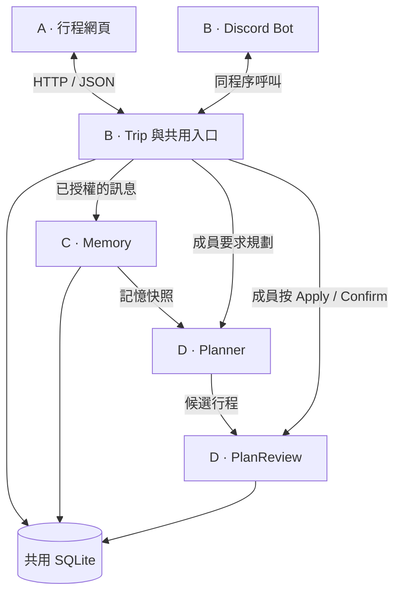

# Waymark M3｜團隊分工與 API 契約 v1

**2026-11-25 · Group 4 · 12/02 提交。** Waymark 幫朋友把 Discord 群聊裡陸續出現的景點和偏好整理成一份共用行程。AI 提出草案，成員可以追查來源、修正理解、接受或拒絕變更。本地 `milestone3/` 目前在設計階段。四個工作包開放認領，A–D 是工作代號，姓名由團隊填入。

## 以 M2 上台版驗收

以 [M2 正式簡報，共 38 頁](../milestone2/slides_presentation.pdf) 為準。A–D 是工程分工，整合展示沿用第 17–20 頁的三個使用情境。

| 簡報 | 使用者要能做什麼 | 誰負責接起來 |
|---|---|---|
| p.13–14、33 · 邀請 | 在 Discord 提及 `@Waymark`，選 From now on 或 Include earlier messages。前者只處理新訊息，後者可匯入同頻道的獲准歷史。拒絕則維持未啟動 | B 控制權限與收集範圍，C 只收到獲准來源 |
| p.17、21、23、29 · 情境 1：分享 | Mia 分享錦市場的 Reel。啟用範圍內自動出現有來源的地點卡，成員可按 ♥／✓／−／×。App 的 Import log 顯示來源、分享者和時間，Map 出現同一地點，投票同步 | C 擷取與辨識，B 更新 Discord 卡片，A 顯示紀錄、地圖與反應 |
| p.18–19、21、34–35 · 情境 2：整理、規劃、修改 | `@Waymark` 後選 From reply／From here／All earlier。摘要分 Decided 和 Undecided，可按 Memory only、Open in app 或 Generate plan。未定的下午行程可投方向票。缺地名先出 Needs details，可補地點或選 Not this time。草案與修改差異回到 Discord 供成員審閱 | B 管觸發、範圍與按鈕，C 保存摘要與來源，D 產生提案，A 支援預覽和修正 |
| p.9、20–21、35–36 · 情境 3：共編 | App 提供每日地圖、附交通的時間表、Groups 與 Drafts 候選區。Day 3 示範 Mia／Yuki 和 Alex／Ben 分開，到 Namba Station 會合。成員可保留空檔、從地圖或候選區加站，亦可比較每段交通再選用 | A 做四種視圖，C 提供候選與座標，D 管分支、集合與交通 |
| p.10、15–16、25、37–38 · 核准與保存 | 成員可編輯提案、Apply 或 Keep original。Confirm／Unconfirm 只更改本人對這一版的意見。Save & finish 先說明保存內容，可取消。儲存後保留來源與待確認者，收集顯示 paused，重開仍能編輯、匯出日曆 | B 維護卡片與暫停收集，D 維護版本與個別確認，A 讀回相同狀態 |

**AI 與工具（p.23–25、28–31）。** M2 把 AI 的四項工作命名為 Understand、Ground、Draft、Revise。C 負責 Understand、Ground 與按要求產生的摘要，用輕量模型處理分享內容，串 Whisper 處理可取得的 Reels 音訊、用 Google Places 辨認地點。D 負責 Draft 與 Revise，在成員要求時使用規劃模型與 Google Routes。簡報提案列 Claude Haiku 5.5／Opus 5.5。以兩個設定鍵記錄實際接通的模型 ID、呼叫分工與成本。程式逐項查驗訊息來源、地點、已知營業時間、交通與成員已確認的步調。M2 估算的每趟約 US$2 留作實測比較。

第 17 頁的流程圖有 nearby picks 示意，第 26 頁將主動探索新地點列入 Later，正式報告的 A2 也註明為未來功能。M3 讓成員用已分享的候選規劃，並保留手動從地圖加入地點的功能。[M2 正式報告](../milestone2/GROUP_4_MILESTONE_2.pdf)

**版本整合案例（p.37）**　Mia 在 Discord 提及 `@Waymark` 並說「第三天十一點再出發，跳過大阪城」。Alex 在網頁看到第三天的變更預覽。Alex 按 **Apply**，兩邊都顯示 v2。Mia 再按 **Confirm**，畫面顯示「1 of 4 confirmed」。這兩個按鈕各有一個後端操作。

## 1. 認領哪一塊

| 工作包 | 誰來做 | 交給其他人的成果 | 可以獨立驗收的第一件事 |
|---|---|---|---|
| **A · 網頁前端** | ＿＿ | React / Vite 網頁、登入入口、API client、旅程／記憶／提案畫面。接地圖、分組、來源修正、直接編輯與日曆下載按鈕 | 用下方範例顯示 v1 與待審差異。按 Apply 時送出契約指定的請求。收到過期錯誤時重新顯示目前版本 |
| **B · Discord、Trip 與系統整合** | ＿＿ | Discord Bot、讀取範圍、身分登入、Fastify HTTP、旅程成員、事件與工作佇列。組裝 C、D 的介面，讓 Bot 與網頁讀寫同一個旅程 | 真實測試頻道可啟用收集。From now on 排除舊訊息。Include earlier messages 只匯入獲准歷史。停止後的新訊息不交給 C |
| **C · 旅程記憶與地點辨識** | ＿＿ | Memory 模組、模型呼叫工具、擷取 prompt、Places 查詢。將獲准的圖文整理成有來源的候選與偏好，接受澄清、投票與修正 | 兩則分享同一景點只產生一筆候選，能回到兩個來源。無法辨識的店名會出現在待澄清清單 |
| **D · 行程生成、交通與版本核准** | ＿＿ | Planner、PlanReview、規劃 prompt、Routes 查詢。產生草案、計算差異、保存接受版本與個別確認，提供日曆內容 | 給定 v1 和同一份記憶，能生成待審提案。拒絕保留 v1，接受只建立一份 v2，舊提案無法覆蓋 v2 |

**AI 的分工**　C 維護共用模型連線與擷取 prompt，D 使用同一個模型介面維護規劃 prompt。**地圖的分工**　C 提供地點、座標與營業資訊，D 估算兩站間的交通，A 把結果畫出來。**整合的分工**　B 提供 HTTP、工作查詢與共用資料庫連線，C、D 各自負責其資料表、交易與測試。每位成員交自己的實測紀錄，A 不必獨力承擔評估與報告。



## 2. 大家共用的 API

HTTP 前綴為 `/api/v1`。A 使用 HTTP，B 的 Bot 在同一個 Node.js 程序呼叫 `TripPort`。兩者取得相同的資料格式、走相同的權限與版本檢查。下面大寫名稱的完整 TypeScript 欄位在本文末，也可直接從 repo 的 [contracts](packages/contracts/src/index.ts) 匯入。**只收到這一份 Markdown 也有完整型別。**

### 登入、加入與讀取

| 方法與路徑 | 送什麼 | 成功回應與用途 |
|---|---|---|
| GET `/auth/discord` | 無 body | 302 到 Discord。B 保存 OAuth state |
| GET `/auth/discord/callback` | Discord 提供的 code、state | B 驗證後建立 HttpOnly session cookie，302 回網頁。登入後可在同一瀏覽器開啟原本的旅程連結 |
| GET `/me` | session cookie | 200 `Member`。未登入回 401 |
| GET `/trips` | session cookie | 200 `TripInfo[]`，列出已加入的旅程 |
| POST `/trips` | `NewTrip` | 201 `TripInfo`。建立者成為成員，每個測試頻道綁定一趟旅程。重複建立回 409 |
| POST `/trips/{t}/join` | 空 body | 200 `TripView`。B 驗證該成員可讀取對應頻道。Bot 的邀請網址包含 trip ID |
| GET `/trips/{t}` | 無 body | 200 `TripView`。單趟完整快照包括成員、收集狀態、記憶、目前已接受行程與待審提案。第一版用於小型旅程，整份讀取 |
| GET `/trips/{t}/proposals/{p}` | 無 body | 200 `Proposal`，可查看已套用、拒絕或過期的提案。Bot 卡片可用 ID 重新讀取狀態 |
| GET `/trips/{t}/jobs/{j}` | 無 body | 200 `Job`。輪詢至終態，取回提案、澄清問題、摘要、記憶版本或失敗原因 |
| GET `/trips/{t}/places/search?q=...` | 成員輸入的地名或地址 | 200 `Place[]`。B 驗證成員，C 搜尋 Places。選中的 placeId 可綁回原候選，或從地圖加新地點 |
| GET `/trips/{t}/routes?version=2&from=s1&to=s2&modes=rail,bus` | 已接受版本、同一段交通的站點 ID、允許的方式 | 200 `RouteOption[]`。預設 Rail + Bus。顯示可取得的時間、票價、轉乘、步驟。Use 將 optionId 送入手動提案。無可用選項回空陣列 |
| GET `/trips/{t}/calendar.ics?version=2` | 已接受版本號 | 200 `text/calendar`。D 匯出指定版本，A 提供下載。版本不存在回 404 |

新旅程的 `collection` 是 `inactive`，`accepted` 是 `null`，基準行程版本是 0。B 先由 cookie 或 Discord event 取得操作者，逐次驗證旅程與頻道存取權。Discord 按鈕記住 trip / proposal / version，操作時仍以**實際按鈕者**身分執行。

### 操作與回應

所有操作都送到 **POST `/trips/{t}/commands`**。每一列的欄位放在同一個 JSON 物件。例：`{"kind":"confirm","planVersion":2}`。HTTP 回應使用下表的型別本身，不另包一層 `data`。

| `kind` | 除 kind 外的欄位 | 負責執行 | 成功回應 |
|---|---|---|---|
| `collect` | `scope: ReadScope` | B，確認範圍後啟動或恢復 | 200 `TripView` |
| `pause` | 無 | B，保存目前接受版、停止收集 | 200 `TripView` |
| `edit_memory` | `memoryRevision, edit: MemoryEdit` | C，人工補景點、澄清、改偏好、排除或投票 | 200 `TripView` |
| `summarize` | `range: SummaryRange` | B 篩選獲准訊息，C 保存摘要、筆記及可選的方向投票，回傳 summaryId | 202 `JobRef` |
| `plan` | `base: Base, request: PlanRequest, replacesProposalId?` | B 固定輸入快照，D 生成首案、自然語言修改或手動修改的預覽 | 202 `JobRef` |
| `answer` | `jobId, text` | B 取回已回覆 clarify 的規劃工作與原始請求，將回答交給 D | 202 新的 `JobRef` |
| `decide` | `proposalId, action: "apply" 或 "reject"` | D，套用或拒絕指定提案 | 200 `TripView` |
| `confirm`／`unconfirm` | `planVersion` | D，記錄或撤回呼叫者對該版本的同意 | 200 `TripView` |

以上成功回應中，`sources[].id` 可用來查該則來源，`candidates[].id` 是旅程內候選 ID，`candidates[].place.id` 是地點供應商的 ID。行程站點只引用候選 ID，一個景點的多次造訪各有自己的 stop ID。

每個 POST 帶 `Idempotency-Key`，例如一次點擊產生的 UUID。Bot 使用 Discord interaction ID。索引以操作者、路徑、key 為範圍。完全相同的重試回原先結果或同一個 job ID，用相同 key 送不同內容回 409。A 以伺服器回傳的版本為準，背景短輪詢更新其他成員的變更。

### 錯誤與狀態

| 情況 | 回應 | 呼叫端行為 |
|---|---|---|
| 尚未登入／無權存取旅程 | 401 `UNAUTHENTICATED`／403 `FORBIDDEN` | 顯示登入入口或所需頻道權限 |
| 旅程中的物件不存在 | 404 `NOT_FOUND` | 重新載入旅程 |
| 格式或參照錯誤／已知不可行的行程 | 422 `INVALID_INPUT`／`INFEASIBLE` | 顯示原因，讓使用者修改 |
| 基準過期／提案已結案／key 重用 | 409 `STALE_BASE`／`ALREADY_DECIDED`／`KEY_REUSED` | 取回最新快照，重新預覽後再操作 |
| 外部模型或地圖服務失敗 | 已受理的 job 進入 `failed`，附 `UPSTREAM_UNAVAILABLE` 與原因 | 顯示重試。單站缺少營業時間、交通估計則以 warning 或 null 呈現 |

錯誤 body 格式為 `{"error":{"code":"STALE_BASE","message":"Refresh this trip and review the new version.","current":{"planVersion":2,"memoryRevision":4}}}`。若 job 開始後才發現資料已變動，查詢 job 仍回 HTTP 200，body 的 `status` 為 `failed`，`error.code` 同樣為 `STALE_BASE`。掛起的 job 可回 `queued` 或 `running`，停止收集而取消的擷取工作回 `cancelled`。

## 3. 後端模組怎麼接

| 介面 · 擁有者 | 呼叫者 | 實作約定 |
|---|---|---|
| `TripPort` · B | A 透過 HTTP，B 的 Bot 直接呼叫 | 將登入者或 Discord 操作者轉成 actor。用 `forChannel` 找旅程，`onMessage` 處理已同意的頻道事件。普通訊息靜默收集，範圍內分享連結自動發地點卡或澄清卡。提及 Bot、按按鈕或回答 Bot 問題才觸發摘要、規劃與修改。B 用 Components v2 更新原 Discord 訊息的進度與結果 |
| `MemoryPort` · C | B 收集、修正、查詢。D 取地點資料 | `ingest` 只接 B 篩過的來源，保留原訊息 ID。相同景點合併來源，無法辨認回候選選項，確定地點後再排入行程。`snapshot` 同次回傳 revision 與資料。`facts` 的 null 是未知，空陣列是當日已知沒有開放區間 |
| `ModelPort` · C | C 的擷取、D 的 Planner | 輸入 prompt、圖文與預期 JSON schema，輸出原始模型結果。C、D 各自驗證 schema。每個模型推論項目的來源 ID 必須指向該次授權輸入或已授權的記憶，無有效來源的項目不採用，模型 ID 和金鑰由後端設定 |
| `PlannerPort`、`RoutesPort` · D | B 的規劃工作呼叫 Planner，Planner 查詢 Routes | B 傳入同版記憶、已接受行程、來源與成員。Planner 回傳候選行程或一個澄清問題。RoutesPort 回傳可用路線供比較，缺少票價或時間則該欄回 null。首次規劃回候選行程，修改既有行程只回具型別的 changes。手動編輯走相同預覽與檢查流程 |
| `ReviewPort` · D | B 的規劃工作與成員操作 | `propose` 對候選與原版計算差異，保存 pending 提案。`decide` 核准才建立接受版，`setConfirmation` 只寫該成員對指定版本的同意 |

**儲存與競爭條件。** B 負責單一 SQLite 連線、migration runner 與旅程／工作表。C、D 管自己的 migration 與資料，三者共用短交易。網路請求在交易外執行。首次草案從版本 0 開始，第一次 Apply 產生 v1。D 建立提案和 Apply 時都比對目前 planVersion 與 memoryRevision。Apply 在同一筆交易中重新確認提案為 pending、寫入新版、結束提案與記錄該次操作。Reject 只結束提案。新版本的確認人數從零開始。D 在伺服器套用 `changes` 產生預覽。移除大阪城只移除該行程站點，候選與來源留在 Drafts。若成員在預覽上按 Edit，送 `replacesProposalId`，以該提案預覽作修改起點。新提案保存成功時將舊提案標為 stale，並以接受版為基準顯示完整差異。新提案仍要經過 Apply。

**收集與修正。** B 先檢查範圍才把訊息交給 C。C 提交擷取結果時在同一個交易再次檢查 epoch 與狀態，並保留使用者已修正的欄位。每次恢復使用新 epoch，排除暫停期間的訊息。B 把規劃請求與補答各記成 Source 以供追溯。只有候選、偏好等規劃資料真正變動時才增加 memory revision。輸入被截斷或私人影片無法讀取時，顯示待澄清並接受文字、截圖或上傳媒體補充。

**澄清。** 產生行程時若 D 回 `clarify`，B 把問題與原始輸入留在 job 上。A 或 Bot 顯示問題，用 `answer` 送回補充並取得新 job。若解答改變了已確認的記憶，先以 `edit_memory` 保存修正，再用新基準重送 `plan`。地點卡片的 Add place 先搜尋輸入的地址，再以 `edit_memory/resolve` 把選中的 placeId 綁回原 candidateId，保留原來源。Not this time 排除該候選。從地圖另加地點時，`add_place` 可帶已選定的 placeId。

**摘要範圍與保存。** `collect.scope` 控制收集授權。`summarize.range` 選擇單次整理範圍，From reply 從被回覆的訊息開始，From here 從指定訊息開始，All earlier 涵蓋獲准歷史。B 以提出要求的訊息為截止，只將授權範圍內的原文交給 C。C 保存涵蓋時間、訊息數、Decided／Undecided 筆記及各自來源，透過 `memory.summaries` 供兩端重讀或修正。Memory only 完成在摘要卡，Generate plan 才送出 draft。方向票用 `vote_option`，四種地點反應用 `vote`。真實 Discord 原文連結放在 `Source.url`，外部貼文連結與平台放在 `sharedPost`。

**交通與空檔。** A 依站點時間顯示未排時段，以未排入行程且未被排除的候選形成 Drafts。D 比較同一路段的可用路線，成員按 Use 時將 `choose_route` 綁定該版本、路段、出發時間與 optionId。接受後才更新兩端。篩選 Rail／Bus 可包含必要的接駁步行。供應商沒有資料的方式顯示無可用路線。

## 4. 四個人共用的第一筆整合範例

以下是**開發用合成資料與預期結果**。Trip `osaka` 在 `Asia/Tokyo`，成員為 Mia、Alex、Ben、Yuki。先用有來源的兩個景點「大阪城」和「難波」建立 v1，第三天原定 08:30 出發、09:00 大阪城、12:00 難波。記憶版本為 4。各組都從這個狀態測同一件事。

| 順序 | 呼叫與內容 | 應看到的結果 |
|---|---|---|
| 1 | B 收到 Mia 對 `@Waymark` 的要求「第三天十一點再出發，跳過大阪城」。以該訊息作為操作來源，送 `{"kind":"plan","base":{"planVersion":1,"memoryRevision":4},"request":{"kind":"revise","instruction":"第三天十一點再出發，跳過大阪城"}}` | 202 `{"jobId":"j7"}`，當前行程仍是 v1 |
| 2 | A 或 B 查 `GET /jobs/j7`（相對於該旅程） | 完成時得到 `{"id":"j7","status":"succeeded","result":{"kind":"proposal","proposalId":"p7"}}` |
| 3 | A 查 `GET /proposals/p7` | `status=pending`，可看到原本與建議的時間、大阪城的移除、變動後的交通，以及受影響的站點。其他天不變 |
| 4 | Alex 送 `{"kind":"decide","proposalId":"p7","action":"apply"}` | 200 `TripView`，`accepted.version=2`、`confirmedBy=[]`。Bot 和網頁各自重讀都顯示 v2 |
| 5 | Mia 送 `{"kind":"confirm","planVersion":2}` | `accepted.confirmedBy=["mia"]`，畫面顯示 1/4。重試同一個操作維持 1/4 |

<details>
<summary>展開開發用測資，可直接給前端與 Planner 當作 GET /trips/osaka 的回應</summary>

```json
{
  "trip": {"id":"osaka","name":"Osaka weekend","channelId":"ch1","timezone":"Asia/Tokyo","firstDate":"2026-11-20","lastDate":"2026-11-22"},
  "members": [{"id":"mia","name":"Mia"},{"id":"alex","name":"Alex"},{"id":"ben","name":"Ben"},{"id":"yuki","name":"Yuki"}],
  "collection": "active", "epoch": 1, "scope": {"mode":"from_now"},
  "memory": {
    "revision": 4, "summaries": [],
    "sources": [
      {"id":"m1","authorId":"mia","text":"Osaka Castle on day 3?","url":null,"at":"2026-11-19T18:00:00+09:00"},
      {"id":"m2","authorId":"ben","text":"Lunch in Namba that day.","url":null,"at":"2026-11-19T18:01:00+09:00"}
    ],
    "candidates": [
      {"id":"c1","label":"Osaka Castle","state":"resolved","place":{"id":"place1","name":"Osaka Castle","coordinates":null},"choices":[],"sourceIds":["m1"],"votes":[]},
      {"id":"c2","label":"Namba","state":"resolved","place":{"id":"place2","name":"Namba","coordinates":null},"choices":[],"sourceIds":["m2"],"votes":[]}
    ],
    "preferences": []
  },
  "accepted": {
    "version": 1, "confirmedBy": [],
    "itinerary": {"days":[
      {"date":"2026-11-20","departAt":"2026-11-20T10:00:00+09:00","stops":[],"legs":[],"split":null},
      {"date":"2026-11-21","departAt":"2026-11-21T10:00:00+09:00","stops":[],"legs":[],"split":null},
      {"date":"2026-11-22","departAt":"2026-11-22T08:30:00+09:00","stops":[
        {"id":"s1","candidateId":"c1","start":"2026-11-22T09:00:00+09:00","end":"2026-11-22T10:30:00+09:00","sourceIds":["m1"]},
        {"id":"s2","candidateId":"c2","start":"2026-11-22T12:00:00+09:00","end":"2026-11-22T13:00:00+09:00","sourceIds":["m2"]}
      ],"legs":[{"fromStopId":"s1","toStopId":"s2","mode":"transit","minutes":null}],"split":null}
    ]}
  },
  "pending": []
}
```

</details>

**第 37 頁的驗收輸出。** D 的 Revise 對上面的 v1 回傳以下兩個操作。PlanReview 套用後重新檢查交通與時間可行性，回傳含完整差異的預覽。Apply 後大阪城回到 Drafts，第 1、2 天與原版一致。範例中的 `m3` 是 B 在步驟 1 記錄的修改請求。

```json
{
  "kind": "patch",
  "changes": [
    {"kind":"retime_day","date":"2026-11-22","departAt":"2026-11-22T11:00:00+09:00"},
    {"kind":"remove_stop","stopId":"s1"}
  ],
  "sourceIds": ["m3"],
  "warnings": []
}
```

**交叉測試**　從步驟 3 重跑，按 Reject 應保留 v1。再從 v1 同時建立兩份提案，接受第一份後，用另一個成員帳號套用第二份應收到 409。另測試同一成員因網路中斷重送同一個 Apply key，應拿到第一次成功的回應。用這三個結果區分拒絕、過期與重試。

## 5. 如何各自跟 AI 開工

將這份檔案提供給各自的 coding AI，附上認領的任務。先要求一個可以執行的小成果，每次交接附上實際執行指令、輸入、觀察結果與已知限制。介面要改時，把受影響的呼叫者一起找來確認，更新共用型別與本文，再合併相依改動。

| 人員 | 可直接交給 AI 的第一個任務 |
|---|---|
| A | 「我負責 Waymark 網頁。請依 v1 契約，在 `apps/web/` 用大阪範例做行程與修改差異畫面，串接 Import log、地點反應、摘要紀錄、地圖／列表／分組／Drafts、路線比較與提案核准。提供可切換的測試資料，讓我能驗收 v1、v2 和 409 三種結果。」 |
| B | 「我負責 Waymark 的 Discord 與共用後端入口。請建立 Node/Fastify 的啟動流程、SQLite migrations 和 TripPort，把 Discord 與 HTTP 操作轉給 C、D。先在測試頻道以 @Waymark 選範圍，分享連結後自動出現可投票的卡片，再示範叫出摘要與按 Generate plan。提供給 A 一個能讀取大阪旅程的本機網址。」 |
| C | 「我負責 Memory、Places 和共用 ModelPort。請從兩筆不同 ID 的同地點分享開始，接一次真實模型擷取，保存一筆候選及兩個來源，示範 Decided／Undecided 摘要可回到原始訊息。另測模糊名稱的澄清、人工修正及晚到的擷取結果。輸出可供 D 規劃的 MemorySnapshot。」 |
| D | 「我負責 Planner、Routes 和 PlanReview。請用大阪 v1 與 revision 4 的記憶，透過 ModelPort 取得調整出發時間和移除景點的 typed changes，套用到基準版算出前後差異並保存 pending。用 SQLite 實測接受、拒絕、重送、兩人同時接受及個別確認，交給 A、B 一筆可操作的提案。」 |

B 維護 `apps/server/src/trip/`、`discord/`、`http/`、`jobs/` 與整合入口。C 維護同層的 `memory/`、`places/`、`model/`。D 維護 `planner/`、`review/`、`routes/`。A 維護 `apps/web/`。需要 SQLite 的工作包各交獨立 migration。B 統整 workspace 與 lockfile。共用契約由提出修改者與使用方一起檢查。

## 6. 接起來的時間與提交內容

| 日期 | 團隊一起驗收的成果 |
|---|---|
| **11/25** | 認領 A–D，確認是否已有其他分支可接。B 確認 Discord 權限與登入，C、D 確認模型及地圖服務可用。四人對齊第 4 節的案例 |
| **11/26–27** | 在同一台電腦接通真 Discord → 真 AI 擷取與規劃 → 網頁預覽 → Apply → 兩個入口讀回同版。先錄一次內部操作 |
| **11/28–29** | 對照 M2 完成來源卡片與補正、圖文與媒體、地圖／交通、手動編輯、兩組分支與集合點、日曆、個別確認及停止收集；各負責人列出可操作與仍卡住的項目 |
| **11/30** | 用三個情境實測。每人交操作畫面與實際結果，共同整理失敗案例、限制和重現方法 |
| **12/01–02** | 12/01 用乾淨環境照 README 重跑，同一版程式錄製英文影片、完成英文報告及 ZIP。12/02 由一人提交 |

**評估計畫（p.26、32）**　目標為約三份經同意的聊天，標註地點、偏好與重複分享，量測擷取／合併正確率與虛構地點數（目標 0）。另規劃邀 3–5 組朋友測試對收集範圍、核准與信任的理解，報告列實際參與組數與結果。

**三個測試情境**　① 大阪三日遊，記錄重複地點合併、來源正確率、已確認偏好是否保留與任務完成時間。② 模糊店名或私人 Reels，確認補件與人工修正能進入下一次規劃。③ 分組後要求局部修改，測試同時套用、拒絕、確認與暫停時仍在執行的擷取。每個情境各寫 Task / Expected / Actual，註明哪些輸入是合成範例、哪些取得參與者同意。影片使用實際模型呼叫與成員操作。

**交付責任**　B 統整可重現的程式 ZIP、安裝說明、外部帳號設定與 `.env.example`。A 統整 2–4 分鐘英文 MP4，各組提供實際畫面。C 整理擷取與修正評估，D 整理規劃與版本評估，兩人彙編 6–8 頁英文 PDF，四人確認報告與提交版一致。LINE、主動推薦未分享景點、向量檢索維持後續方向。若某項 M2 關鍵功能交不出來，應在組內提早說明，記錄範圍變更與實測限制。[M3 作業規格](https://docs.google.com/document/d/1f_e977FQVdIpVFO7rHM773MVLVu1sZUJekJLDzXhDFg/edit) · [M2 原型](https://claude.ai/artifact/75jXxDxX1EwALYK2eui1Xs)

## 附錄 · 可直接交給 AI 的 TypeScript 契約

日期用 YYYY-MM-DD。每天的 `departAt` 是團體出發的時間，第一個停留點的 `start` 是抵達後開始造訪的時間。站點與交通出發時間用帶 UTC offset 的 ISO 8601 字串。所有 ID 為字串。stop ID 跨版本保持穩定。重新排序時傳完整的同日主線 stop ID，分組時以共同站點 ID 指定分開與集合位置。資料未知使用 null。當 `accepted` 為 null，新的規劃請求傳 `base.planVersion=0`。每個範例中的 `{t}`、`{p}`、`{j}` 都使用前一步取得的 ID 代入。

<details>
<summary>展開完整型別與模組函式簽名</summary>

```ts
// Waymark v1. These declarations are shared by the web client, Discord adapter and server.
export type Id = string
export type Actor = { memberId: Id } // Created by the server from an authenticated session or Gateway event.
export type Member = { id: Id; name: string }
export type ReadScope =
  | { mode: 'from_now' | 'history' }
  | { mode: 'from_message'; messageId: Id }

// A summary selects raw messages inside the already authorized collection window.
export type SummaryRange =
  | { mode: 'from_reply' | 'from_here'; messageId: Id }
  | { mode: 'all_earlier' }
export type Reaction = 'heart' | 'check' | 'minus' | 'cross'
export type SavedSummary = {
  id: Id; range: SummaryRange; firstAt: string; lastAt: string; messageCount: number
  notes: { id: Id; state: 'decided' | 'undecided'; text: string; sourceIds: Id[] }[]
  poll: { id: Id; question: string; options: { id: Id; label: string; voterIds: Id[] }[] } | null
}
export type Source = {
  id: Id; authorId: Id; text: string; url: string | null; at: string
  sharedPost?: { url: string; platform: string; author: string | null; thumbnailUrl: string | null }
}
export type ScopedSource = {
  tripId: Id; epoch: number; source: Source
  media: { kind: 'link' | 'image' | 'video' | 'audio'; url: string }[]
}
export type Place = {
  id: Id; name: string; coordinates: { lat: number; lng: number } | null
}
export type Candidate = {
  id: Id; label: string; state: 'unresolved' | 'resolved' | 'excluded'
  place: Place | null; choices: Place[]; sourceIds: Id[]
  votes: { memberId: Id; value: Reaction }[]
  tags?: string[]; description?: string
}
export type Preference = {
  id: Id; memberId: Id; text: string; confirmed: boolean; sourceIds: Id[]
}
export type MemorySnapshot = {
  summaries: SavedSummary[]
  revision: number; candidates: Candidate[]; preferences: Preference[]; sources: Source[]
}
export type MemoryEdit =
  | { kind: 'resolve'; candidateId: Id; placeId: Id }
  | { kind: 'add_place'; label: string; url?: string; placeId?: Id }
  | { kind: 'exclude'; candidateId: Id }
  | { kind: 'preference'; preferenceId: Id; text: string; confirmed: boolean }
  | { kind: 'vote'; candidateId: Id; value: Reaction | null }
  | { kind: 'edit_note'; summaryId: Id; noteId: Id; text: string }
  | { kind: 'vote_option'; summaryId: Id; pollId: Id; optionId: Id | null }

export type Mode = 'walk' | 'rail' | 'bus' | 'taxi' | 'bike' | 'drive'
export type RouteOption = {
  id: Id; minutes: number | null; fare: { amount: number; currency: string } | null
  transfers: number | null; steps: { mode: Mode; label: string; minutes: number | null }[]
}
export type Stop = {
  id: Id; candidateId: Id; start: string; end: string; sourceIds: Id[]
}
export type Leg = {
  fromStopId: Id; toStopId: Id; mode: Mode | 'transit'; minutes: number | null; route?: RouteOption
}
export type Branch = { memberIds: Id[]; stops: Stop[]; legs: Leg[] }
export type Day = {
  date: string; departAt: string; stops: Stop[]; legs: Leg[]
  split: { afterStopId: Id; branches: [Branch, Branch]; meetingStopId: Id } | null
}
export type Itinerary = { days: Day[] }
export type AcceptedPlan = { version: number; itinerary: Itinerary; confirmedBy: Id[] }
export type ManualChange =
  | { kind: 'add_stop'; date: string; candidateId: Id; start: string; end: string }
  | { kind: 'remove_stop'; stopId: Id }
  | { kind: 'retime'; stopId: Id; start: string; end: string }
  | { kind: 'retime_day'; date: string; departAt: string }
  | { kind: 'reorder'; date: string; stopIds: Id[] }
  | { kind: 'split'; date: string; split: Day['split'] }
  | { kind: 'choose_route'; fromStopId: Id; toStopId: Id; optionId: Id }
export type PlanRequest =
  | { kind: 'draft' }
  | { kind: 'revise'; instruction: string }
  | { kind: 'manual'; changes: ManualChange[] }
export type Base = { planVersion: number; memoryRevision: number }
export type Warning = { code: string; message: string; stopId?: Id }
export type Proposal = {
  id: Id; base: Base; status: 'pending' | 'accepted' | 'rejected' | 'stale'
  preview: Itinerary; differences: string[]; warnings: Warning[]; sourceIds: Id[]
}
export type Outcome =
  | { kind: 'proposal'; proposalId: Id }
  | { kind: 'clarify'; question: string }
  | { kind: 'memory'; revision: number }
  | { kind: 'summary'; summaryId: Id; sourceIds: Id[] }
export type ApiError = { error: { code: string; message: string; current?: Base } }
export type Job =
  | { id: Id; status: 'queued' | 'running' | 'cancelled' }
  | { id: Id; status: 'succeeded'; result: Outcome }
  | { id: Id; status: 'failed'; error: ApiError['error'] }
export type JobRef = { jobId: Id }

export type TripInfo = {
  id: Id; name: string; channelId: Id; timezone: string; firstDate: string; lastDate: string
}
export type TripView = {
  trip: TripInfo; members: Member[]; collection: 'inactive' | 'active' | 'paused'
  epoch: number; scope: ReadScope | null; memory: MemorySnapshot
  accepted: AcceptedPlan | null; pending: Proposal[]
}
export type NewTrip = Omit<TripInfo, 'id'>
export type SyncCommand =
  | { kind: 'collect'; scope: ReadScope }
  | { kind: 'pause' }
  | { kind: 'edit_memory'; memoryRevision: number; edit: MemoryEdit }
  | { kind: 'decide'; proposalId: Id; action: 'apply' | 'reject' }
  | { kind: 'confirm' | 'unconfirm'; planVersion: number }
export type AsyncCommand =
  | { kind: 'summarize'; range: SummaryRange }
  | { kind: 'plan'; base: Base; request: PlanRequest; replacesProposalId?: Id }
  | { kind: 'answer'; jobId: Id; text: string }
export type Command = SyncCommand | AsyncCommand

// Session and event identity enter through B. Ports below run inside the shared server.
export interface TripPort {
  list(actor: Actor): Promise<TripInfo[]>
  forChannel(actor: Actor, channelId: Id): Promise<TripInfo | null>
  create(actor: Actor, input: NewTrip, key: Id): Promise<TripInfo>
  join(actor: Actor, tripId: Id, key: Id): Promise<TripView>
  view(actor: Actor, tripId: Id): Promise<TripView>
  proposal(actor: Actor, tripId: Id, proposalId: Id): Promise<Proposal>
  searchPlaces(actor: Actor, tripId: Id, query: string): Promise<Place[]>
  routeOptions(actor: Actor, tripId: Id, version: number, fromStopId: Id, toStopId: Id, modes: Mode[]): Promise<RouteOption[]>
  job(actor: Actor, tripId: Id, jobId: Id): Promise<Job>
  calendar(actor: Actor, tripId: Id, version: number): Promise<string>
  onMessage(channelId: Id, source: Source, media: ScopedSource['media']): Promise<JobRef | null>
  run(actor: Actor, tripId: Id, cmd: SyncCommand, key: Id): Promise<TripView>
  run(actor: Actor, tripId: Id, cmd: AsyncCommand, key: Id): Promise<JobRef>
}
export type PlaceFacts = {
  placeId: Id; openingIntervals: { start: string; end: string }[] | null
}
export interface MemoryPort {
  ingest(input: ScopedSource): Promise<void>
  snapshot(tripId: Id): Promise<MemorySnapshot>
  edit(actor: Actor, tripId: Id, atRevision: number, edit: MemoryEdit): Promise<void>
  summarize(tripId: Id, range: SummaryRange, allowedSources: Source[]): Promise<Extract<Outcome, { kind: 'summary' }>>
  searchPlaces(tripId: Id, query: string): Promise<Place[]>
  facts(placeId: Id, date: string, timezone: string): Promise<PlaceFacts>
}
export interface TranscriptionPort {
  transcribe(input: { sourceId: Id; audio: Uint8Array }): Promise<{ text: string; sourceId: Id }>
}
export type GenerationInput = {
  trip: TripInfo; members: Member[]; memory: MemorySnapshot; accepted: AcceptedPlan | null
  request: PlanRequest; requestSourceId: Id; answers: Source[]; editing: Proposal | null
}
export type DraftResult =
  | { kind: 'drafted'; preview: Itinerary; sourceIds: Id[]; warnings: Warning[] }
  | { kind: 'patch'; changes: ManualChange[]; sourceIds: Id[]; warnings: Warning[] }
  | Extract<Outcome, { kind: 'clarify' }>
export interface PlannerPort {
  generate(input: GenerationInput): Promise<DraftResult>
}
export interface ReviewPort {
  accepted(tripId: Id): Promise<AcceptedPlan | null>
  pending(tripId: Id): Promise<Proposal[]>
  get(tripId: Id, proposalId: Id): Promise<Proposal>
  propose(tripId: Id, base: Base, draft: Exclude<DraftResult, {kind: 'clarify'}>, replacesProposalId?: Id): Promise<Proposal>
  decide(actor: Actor, tripId: Id, proposalId: Id, action: 'apply' | 'reject', key: Id): Promise<void>
  setConfirmation(actor: Actor, tripId: Id, version: number, confirmed: boolean, key: Id): Promise<void>
  calendar(tripId: Id, version: number): Promise<string>
}
export interface ModelPort {
  generate(input: {
    task: 'extract' | 'ground' | 'summarize' | 'draft' | 'revise'; instruction: string; text: string; images?: string[]
    jsonSchema: Record<string, unknown>
  }): Promise<unknown>
}
export interface RoutesPort {
  options(fromPlaceId: Id, toPlaceId: Id, departAt: string, modes: Mode[]): Promise<RouteOption[]>
}
```

</details>
